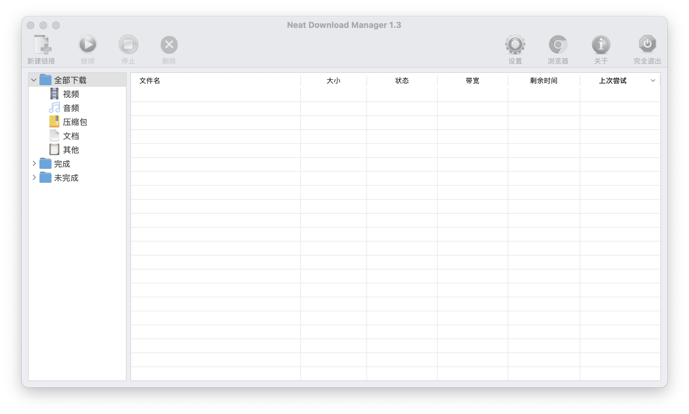

# NeatDownloadManager 中文汉化（macOS）

把 [NeatDownloadManager 1.3](https://www.neatdownloadmanager.com/) 的界面、状态、菜单汉化成简体中文。
**仓库不含任何原程序文件**——所有汉化资源在你本机安装时，从你已装的 NDM 现场生成。

[](./LICENSE)
[](#)
[](#)

---

## 效果预览



侧边栏分类、工具栏按钮、下载列表表头全部中文，图标保留。

---

## ⚠️ 法律声明（必读）

NeatDownloadManager 的版权归原作者 **Javad Motallebi** 所有
（`Info.plist`：`Copyright © 2021 Javad Motallebi. All rights reserved.`）。

本仓库**仅分发**：

- 汉化脚本（`tools/*.py`、`install.sh`、`*.command`）
- 翻译表（`translations/*.json`，贡献者编写的 `{英文: 中文}` 映射）

安装时脚本读取**你本机已装**的 NDM，就地生成中文资源，**不复制、不重新分发**任何原程序二进制或资源。

> **请勿**在 GitHub Release 中附带修改后的二进制或原程序文件。只分享本仓库源码即可。

---

## 快速开始

要求：本机已安装 **NeatDownloadManager 1.3**（位于 `/Applications/NeatDownloadManager.app`），且装了 **Python 3**。

```bash
git clone https://github.com/shixueaaa811001/NeatDownloadManager-zh.git
cd NeatDownloadManager-zh
# 双击 install.command，或在终端执行：
./install.sh
```

安装器自动完成：退出 NDM → 备份原版主程序 → 汉化二进制 → 生成 `zh-Hans.lproj` →
生成中文图标别名 → ad-hoc 重签 → 去掉隔离属性 → 启动。

## 卸载

```bash
./uninstall.command
```

从备份还原主程序并删除汉化资源，回到英文原版。

---

## 工作原理

| 层 | 做法 | 脚本 |
|---|---|---|
| 二进制内置串 | NDM 按 **UTF-16LE** 读取 CFString，所以译文以 UTF-16LE 写入填充区，并改 `ptr` / `length` / `flags`；无 CFString 的串就地写。 | `tools/patch16.py` |
| nib 文案 | 读你已装的 nib，按表替换**用户可见**的字符串值（标题、标签、提示），不动类名 / keyPath / action，写入 `zh-Hans.lproj`。 | `tools/build_nibs.py` |
| 图标 | `[NSImage imageNamed:]` 以分类名查找——翻译标签后需按中文名查找，安装器把原图标复制为中文名别名放入 `Resources/`。 | `install.sh` |

---

## 目录结构

```
NeatDownloadManager-zh/
├── install.command        # 双击运行 = ./install.sh
├── install.sh             # 6 步装机脚本
├── uninstall.command      # 一键还原英文原版
├── LICENSE                # MIT
├── README.md
├── images/
│   └── preview.png        # 中文主界面预览
├── tools/
│   ├── patch16.py         # 二进制 UTF-16 重定向
│   ├── build_nibs.py      # nib 文案翻译
│   └── cfstring.py        # CFString / Mach-O 解析辅助
└── translations/
    ├── binary.json            # 二进制串 {英文:中文}
    ├── binary_overflow.json   # 重定向溢出表
    └── nib.json               # nib 文案表
```

---

## 已知限制

- 约 10 条 FTP 调试提示保留英文（不影响日常使用）。
- 窗口标题 `Neat Download Manager 1.3` 保留英文。
- 标准按钮 `OK` 未做强制本地化。

---

## 参考

- [hardwin2023/NeatDownloadManager-zh](https://github.com/hardwin2023/NeatDownloadManager-zh)（macOS，仅 nib 层）
- [qiqi258/NeatDownloadManager-zh](https://github.com/qiqi258/NeatDownloadManager-zh)（Windows，纯脚本）

本方案在它们基础上做到了**二进制 UTF-16 汉化**与**图标别名恢复**。